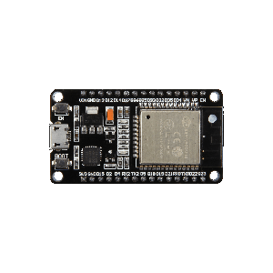

  <i>Now working on NNeural, a C library for simplify MLPs and Perceptrons</i>

---

### DDumper
**[DDumper](https://github.com/CaioKotan/DDumper)** — A visual tool for hex-dumping files, designed to make binary data extraction and inspection easier.
### NNeural
**[NNeural](https://github.com/CaioKotan/NNeural)** — Coming soon: an AI built entirely in C; for now, a simplified way to build artificial neurons (perceptrons).

### About Me

I'm an **Industrial Automation** student interested in software development, embedded systems, and low-level programming.
I work with microcontrollers such as the **ESP32**, developing projects involving **IoT**, **automation**, **hardware integration**, and **connectivity**. I also enjoy building desktop applications and developer tools that solve practical problems.

### Technologies & Tools

  
  
  
  
   
  
  
  
   
  
  
  

### Stats

  
  
  
  

---

  <i></i>

